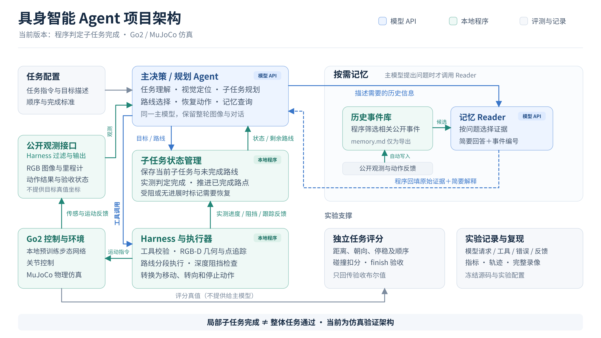

# Go2 通用大模型＋视觉几何 Harness Demo

## planning-v2：通用子任务与按需记忆

本分支使用 `go2_demo.general_episode_run` 作为通用 Agent 入口。主模型负责目标、数字路点、恢复动作和记忆查询；默认由程序依据实测结果判断局部子任务完成、推进路线并标记需要恢复。任务是否真正通过仍由独立评分器判定。



[架构与工作流说明](docs/general-agent.zh-CN.md) · [可编辑架构 SVG](docs/images/project-architecture-measured.svg)

- 默认 `--subgoal-updates measured`；`agent` 保留为模型自主更新子任务的可选消融模式。
- `--mode query` 启用事件记忆和按需 Reader；`empty` 关闭额外 Reader。两组均保留整轮图像、对话和工具反馈，不能把 `empty` 理解成完全没有上下文记忆。
- 主决策模型同时承担规划，没有额外独立规划模型 API。Reader 仅按问题筛选已记录的公开事件，`memory.md` 是导出文件。
- 连续错误次数默认不终止任务（`--max-consecutive-errors 0`）；总请求数、原生动作、时间和跌倒终止仍有效。碰撞记录并扣分后继续。
- 通用核心不写死 A/B 阶段、颜色阈值检测、绕柜提示或返程专用检索类别；任务描述与完成条件在配置中声明。仍使用仿真里程计及既有边界保护，不代表真实机器人 SLAM 或真机实验已完成。

安装项目依赖、按 `assets.lock.json` 获取资产后，在仓库根目录运行。密钥文件放在仓库之外，示例路径只需替换为自己的本地文件，不要将真实密钥写入命令或提交：

```bash
# 只检查配置，不启动仿真或调用模型
python -m go2_demo.general_episode_run \
  --task-config configs/general_agent/occluded_return.json --validate-only

# 新建有记忆＋子任务的一轮运行；此命令会调用模型 API
MUJOCO_GL=egl OMP_NUM_THREADS=1 MKL_NUM_THREADS=1 PYTHONPATH=. \
python -m go2_demo.general_episode_run \
  --task-config configs/general_agent/occluded_return.json \
  --subgoal-updates measured --mode query \
  --provider deepseek --model deepseek-flash \
  --api-key-file /path/to/key.txt --assets-dir assets \
  --max-requests 1024 --max-reader-requests 16 \
  --max-native-actions 460 --actions-per-slice 6 \
  --max-sim-seconds 1880 --max-wall-seconds 4468 \
  --max-consecutive-errors 0 \
  --output runs/planning-v2-query-new
```

无外部记忆对照改为 `--mode empty` 并使用新的输出目录。单目标配置为 `configs/general_agent/single_object.json`。每轮记录原始请求图像、公开事件、实际轨迹、独立评分和录像姿态；可离线导出录像：

```bash
MUJOCO_GL=egl python -m go2_demo.general_video runs/planning-v2-query-new/capture

python -m pytest tests/test_general_subgoals.py tests/test_general_agent.py \
  tests/test_general_run.py tests/test_general_memory.py \
  tests/test_general_execution.py tests/test_memory_maze_agent.py -q
```

录像导出需要可用的 FFmpeg。`scripts/check_general_agent_offline.py` 使用本地 MockTransport 和真实 MuJoCo，当前显式覆盖可选 `agent` 更新模式；它不评价模型识别能力，也不产生外部 API 请求。`scripts/archive_general_episode.py` 是高级 A/B 归档入口，要求事先冻结实验配置和源码，不是普通运行后的必要步骤。

已有历史成功演示不能证明外部记忆收益：成功样例没有实际查询记忆；通用版的已有单轮结果也不足以证明稳定增益。本分支发布的是当前架构及可复现接口，旧实验分数应结合其冻结版本与实验条件解读。最新中断运行不作为完整失败成绩。

## 历史入口与实验说明

以下保留 `planning-v1` 及更早入口的使用说明；其中思考模式、预算和任务特化逻辑不等同于上面的通用入口。

[A→B 遮挡导航复现说明、H0/H2 全程录像与评分记录](docs/occluded-handoff.zh-CN.md)

[固定 A 停靠状态的返程消融：直接阅读与按需记忆问答](docs/occluded-query.zh-CN.md)

[planning-v1：持续子目标、完整上下文与碰撞扣分](docs/fresh-subgoal.zh-CN.md)

历史 planning-v1 的 A/B 实验入口为 `python -m go2_demo.fresh_episode_run --navigation subgoal --handoff-context retain`：模型自主规划路点，执行器分段执行、检查进度并支持恢复；A→B 保留完整公开对话，碰撞记录扣分后继续。无额外记忆与按需记忆两组从起点独立运行，完整命令见上方说明。该实验入口使用 `deepseek-flash`，关闭思考，与下文通用 CLI 的配置不同。

planning-v1 的历史对照见 [r4 报告](results/fresh-subgoal-retain-24x18-s0-1024-r4/report.zh-CN.md)、[指标汇总](results/fresh-subgoal-retain-24x18-s0-1024-r4/summary.json)和 [有记忆组全程录像（A/B 标注，停稳段压缩）](results/fresh-subgoal-retain-24x18-s0-1024-r4/query/full-labeled-compressed.mp4)。本轮有记忆组通过、得分 95，无额外记忆组未通过、得分 0；但有记忆组没有调用外部记忆查询，不能将这次差异归因于记忆检索。

一个在 **MuJoCo 中运行真实 Go2 关节动力学**的最小闭环：观察机载 RGB 图像 → 选取目标像素 → RGB-D 几何跟踪 → 调用短程移动工具 → 接收执行反馈 → 独立评分。

现在可选择 **13 个新闭环场景**：接近不同颜色物体、辨别 A/B/C、绕过家具、穿过矩形或三角形门框。原始红色标记任务保留为 `red_marker`；两项低姿态爬行任务明确标为当前不支持。

通用 CLI（`python -m go2_demo`）通过 **开启思考的模型 API** 决策。默认使用支持图片与工具调用的 DeepSeek；模型自行选点、选择动作并声明完成。多轮工具调用保留并回传完整的 `reasoning_content`。

低层复用固定版本的 Go2 预训练步态策略；无需安装 ROS、Isaac Sim，也无需先训练策略。支持平地移动与转向，**不支持机身高度／俯仰控制**。长期记忆和持续子目标的实验实现见上方 A/B 文档。

当前入口和场景说明见 [新场景测试](docs/scenarios.md)，实测记录见 [验证记录](docs/validation.md)。此前规则策略和非思考 API 的结果保留为历史记录，不作为当前思考模式的成绩。

穿门任务已补齐相机／机身标定、实际累计里程计和公开完成余量。保持原评分后，本轮红色三角、绿色矩形和黄色三角三项思考 API 验证均通过，自动测试为 230 项通过；方法、协议变化及适用范围见 [穿门修复说明](docs/passage-solution.md)。

## 当前 WSL 工作区

已在 WSL2 / Ubuntu 24.04 中创建独立的 Linux `.venv`，使用 Python 3.11.15、MuJoCo 3.2.5 和 PyTorch 2.5.1+cpu。当前工作区可直接启动：

```bash
# 在克隆后的仓库根目录运行
source .venv/bin/activate
unset MUJOCO_GL
./scripts/run_deepseek.sh --task go_to_blue_ball --viewer --seed 0
```

窗口通过 WSLg 显示；去掉 `--viewer` 可只运行闭环并保存日志，默认 GLFW 仍需要 WSLg 显示服务。启动脚本从上一级目录的 `deepseekapi.txt` 读取 API 密钥。原 Windows 虚拟环境已保留在 `.venv.windows-backup/`，WSL 使用 `.venv/bin/python`。

已配置 DeepSeek 时，可直接选择新样例或连续运行：

```bash
./scripts/run_deepseek.sh --list-tasks
./scripts/run_deepseek.sh --task distinguish_texture_b --viewer
./scripts/run_deepseek.sh --task go_avoid_texture_sofa --viewer
./scripts/run_deepseek.sh --suite quard-planar --viewer
```

`run_deepseek.sh --viewer` 默认运行新的蓝色球体任务。原始场景需显式选择 `--task red_marker`。完整列表、逐项结果和评分说明见 [新场景测试](docs/scenarios.md)；QUARD 离线文件检查使用下方独立入口。

## 快速开始：Ubuntu

推荐 Python 3.11。先进入本目录，再创建独立环境：

将项目复制到其他 Ubuntu 工作区时可保留 `assets/`，但不要复用 Windows 的 `.venv/`；按下面命令重新创建环境。当前 WSL 工作区已经完成安装，无需重复执行这一节。

```bash
cd '/你的路径/Agent+harness'
python3.11 -m venv .venv
source .venv/bin/activate
python -m pip install --upgrade pip
python -m pip install 'torch>=2.2,<3' --index-url https://download.pytorch.org/whl/cpu
python -m pip install -e '.[test]'
python scripts/fetch_assets.py
./scripts/run_deepseek.sh --viewer --seed 0
```

`fetch_assets.py` 按 `assets.lock.json` 下载并校验模型、网格、策略权重和许可证；已有文件校验通过后不会重复下载。首次安装需要联网。上面的 CPU 版 PyTorch 足以运行步态策略，可减少 CUDA 依赖下载；已有可用 PyTorch 时跳过这一行。启动前在项目上一级准备 `deepseekapi.txt`，或通过 `--api-key-file` 指定凭据文件。

有 NVIDIA 驱动、通过 SSH 无桌面运行时，可使用 EGL 离屏渲染：

```bash
MUJOCO_GL=egl ./scripts/run_deepseek.sh --seed 0
```

使用 `--viewer` 时保留默认 GLFW，不要同时设置 `MUJOCO_GL=egl` 或 `osmesa`。更多环境说明见 [运行说明](docs/demo.md)。

## 接入通用模型 API

当前 WSL 工作区可直接从上一级目录的 `deepseekapi.txt` 读取密钥：

```bash
./scripts/run_deepseek.sh --viewer --seed 0
```

该启动入口使用 DeepSeek 官方端点、支持图片的 `deepseek-flash`，固定设置 `thinking={"type":"enabled"}`，并直连服务以避开本机失效代理。密钥只在进程内读取；文件权限已设为 `600`，并加入忽略规则。指定其他密钥文件时可追加 `--api-key-file /path/to/key.txt`。

默认每次请求输出预算为 8192 token（包含思考），API 超时 90 秒，每项任务墙钟预算 300 秒。可通过 `--max-output-tokens`、`--api-timeout` 和 `--max-wall-seconds` 调整。思考内容与助手消息只在进程内用于后续工具轮次回传；日志记录思考字符数，不保存原始思考文本。参数依据 [DeepSeek 思考模式文档](https://api-docs.deepseek.com/guides/thinking_mode/)。

其他兼容服务可按下面方式配置：

兼容服务需要支持**图片、Function Calling、开启思考及思考字段回传**，并返回非流式 Chat Completions。

```bash
export MODEL_BASE_URL='https://你的服务地址/v1'
export MODEL_NAME='你的视觉模型标识'
read -rsp 'MODEL_API_KEY: ' MODEL_API_KEY
echo
export MODEL_API_KEY

python -m go2_demo --provider compatible --viewer --seed 0
```

也可设置 `MODEL_API_KEY_FILE=/path/to/key.txt` 代替 `MODEL_API_KEY`；显式 `--api-key-file` 的优先级最高，其次是环境密钥和环境密钥文件。程序不会自动读取 `.env`。`MODEL_BASE_URL` 应包含服务商要求的兼容 API 前缀；程序会添加 `/chat/completions`。本地无鉴权服务可用服务所接受的非空占位 Key。

通用 CLI 只接受 API 方式，并固定开启思考。其他服务商的专用推理协议或仅流式返回的端点需要另外适配。独立 A/B 实验入口的模型与上下文配置以 [持续子目标说明](docs/fresh-subgoal.zh-CN.md)为准。QUARD 离线数据检查与单元测试继续保留，作为数据和接口验证。

## 看结果与运行测试

每次运行单独写入 `runs/`：

```text
runs/<运行标识>/
├── manifest.json       # 配置、模式、资产版本等
├── events.jsonl        # API 决策、思考字符数、工具请求和反馈
├── trajectory.jsonl    # 仿真轨迹；包含评测用状态
├── metrics.json        # 独立判定、结束原因、时间和成本计数
└── frames/             # 机载相机图像
```

API Key 与认证头不写入日志。仿真目标真值用于独立评分，不作为目标坐标直接提供给模型。`finish()` 只是完成声明，最终成绩以 `metrics.json` 为准。

```bash
python -m pytest -q
python scripts/fetch_assets.py --verify
```

## 论文中的 QUARD 数据集测试

已接入 [QUARD 官方数据](https://huggingface.co/datasets/Tong314/QUARD)的固定版本小样本：从纹理辨别、目标到达、避障、隧道穿行和爬行五类中选择 15 个公开任务，每个任务保留一段跨 2 秒的四帧轨迹。原始指令、RGB、深度图和控制标签一同保存；来源及逐文件 SHA-256 记录在 `datasets/quard.lock.json`。

当前 WSL 工作区已下载样本，可直接检查：

```bash
python scripts/fetch_quard.py --verify
python -m pytest -q tests/test_quard_dataset.py
python -m go2_demo.quard --report runs/quard/report.json
```

复制项目到其他机器后，运行 `python scripts/fetch_quard.py` 可重新获取这些样本，也可用 `--task go_to_red_cube` 只下载单个任务。完整 `pytest` 会运行已下载数据的回归测试，缺少对应任务数据时明确跳过，不自动联网下载。

这是原始数据读取、时序和标签的离线验证，与当前 Go2 MuJoCo 闭环分开。论文没有公开确切的 15 任务及 Uv／Ul 划分，因此本子集不作为论文成功率复现；原始深度 PNG 也不作为米制深度使用。下载、标签语义及覆盖范围见 [QUARD 测试说明](docs/quard.md)。

## 当前边界

- 模型思考期间暂停仿真，日志标记为 `paused_during_model_inference`；不代表实时机器人已验证。
- 关键点跟踪面向静态场景，丢点后返回失效状态，由决策方重新选点；没有自动全局寻路与绕障。
- 使用仿真提供的相机标定和本体位姿，尚未验证真实传感器噪声、里程计漂移或实机迁移。
- 动作按预训练策略驱动关节，不通过瞬移机身完成移动；高度／俯仰能力不做假实现。
- 本项目是受 RoboHarness 启发的最小 Go2 demo，不是论文全部功能或成绩的复现。

详细接口、指标和排错见 [docs/demo.md](docs/demo.md)。原有完整研究设计保存在 [docs/design-plan.md](docs/design-plan.md)，其中的后续模块仍是计划，不等同于已实现功能。

参考：[RoboHarness](https://github.com/BinceQu/RoboHarness)、[Go2 控制器来源](https://github.com/wty-yy/go2_rl_lab/tree/24859ea57953624de8208ddc11b606ebfec5c99c)、[第三方说明](THIRD_PARTY_NOTICES.md)。
