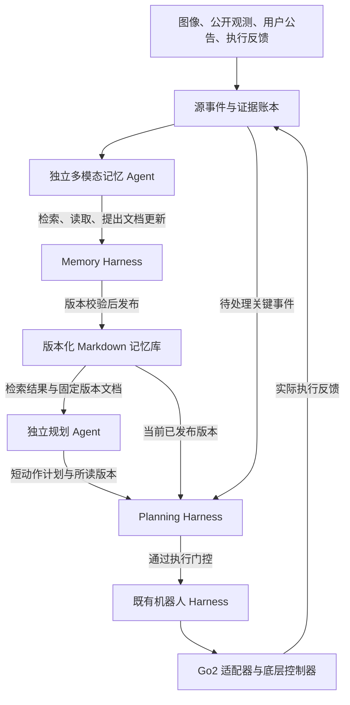

# 异步 Markdown 记忆 Agent demo

这个 demo 将记忆整理和动作规划拆成两条独立的模型调用链。记忆 Agent 接收公开图像、传感器摘要、用户公告与执行反馈，自主决定保存哪些语义、写入哪个 Markdown 文档以及如何修订；规划 Agent 检索并读取已经发布的记忆版本，再提出一个短动作计划。Harness 负责证据引用、版本一致性和执行边界，现有 Go2 控制器负责真正运动。

它用于验证“独立记忆处理、可交班的文档、异步更新与旧计划失效”这条最小闭环。它不属于已有模型评分榜单，也不等同于完整室外 SLAM、对象重识别或多区导航系统。

## 两条调用链



记忆 worker 有自己的模型实例、上下文和调用记录。规划器等待或发生请求故障时，已经进入账本的证据不随它的短期上下文一起丢失。异步不意味着记忆立即可用：规划器能够区分“源事件已经收到”与“记忆 Agent 已处理并发布”，关键事件尚未处理时不把旧文档当成最新状态。

程序负责把源事实和原始图像引用可靠地入账，不负责替模型摘录订单答案。记忆 Agent 的文字仍是需要引用来源的语义判断；引用存在只能证明可追溯，不能自动证明文字准确。外部公告、图像文字和记忆文档均作为数据读取，不能修改系统提示词或工具权限。

## 最小演示过程

1. 第一轮收到生效公告 R1 和当前公开观测。记忆 Agent 阅读证据，自主选择文档路径和正文，提交第一个记忆版本。
2. 规划 Agent 从空白规划上下文开始，检索、读取这个版本，提出 R1 对应的短横移动作。计划通过门控后才交给机器人 Harness；实际反馈进入事件账本。
3. 新公告 R2 将本次动作方向改为反向，同时提供明确标为 `ARCHIVED` 的旧 R1。记忆 worker 异步处理更新。记忆内容和采用哪一份公告由模型决定，程序不改写成预期答案。
4. 旧计划接受一次失效探测。在关键新事件待处理时返回 `MEMORY_PENDING`；若后台恰好已完成相关文档更新，则返回 `MEMORY_CHANGED`。两者都表示旧计划被拒绝，拒绝结果进入记录，不作为已经执行的机器人动作。
5. 第二轮使用全新的规划上下文，从已发布 Markdown 恢复当前指令，再提出短动作。独立验收检查是否采用有效修订、是否读到该记忆版本以及机器人实际执行反馈。

这里的“交班”指创建一个新的规划模型实例并清空规划历史。两轮使用同一个机器人后端和连续世界，不重置机器人，也不重启操作系统进程。原始 R1、R2 与历史回放均保留，旧记忆版本也保留，避免把修订覆盖误作从未发生。

## Markdown 记忆与版本读取

实际存储使用以下目录。文档路径和正文由记忆 Agent 在允许的范围内选择，`MEMORY.md` 和各类文档都是可选项，不由程序固定生成答案：

```text
memory/
  index.sqlite3                  # 事件账本、发布指针、提交回执
  evidence/                      # 登记过的公开图像
  revisions/
    <version-uuid>/
      manifest.json              # 本版本文件、哈希、来源与处理水位
      MEMORY.md                  # 可选索引文档
      tasks/<name>.md            # 可选任务记忆
      episodes/<name>.md         # 可选经验片段
      objects/<name>.md          # 可选对象记忆
      places/<name>.md           # 可选地点记忆
      knowledge/<name>.md        # 可选知识记忆
```

每份已发布快照是不可变的；一个读取操作绑定一个具体版本，不能先从旧版检索，再无提示地读取新版正文。规划结果记录所依据的发布版本及实际读取文档的哈希，执行前再次核对依赖；无关文档更新不会仅因全局版本号变化而阻止当前计划。Markdown 是语义正文，SQLite 保存事件和发布元数据，不另存一套可以独立修改的语义正文。文档索引与图像、数值反馈分开存储，避免把整段原始传感器流重复写成 Markdown。

世界作用域与机器人能力配置分开：同一环境中的对象、任务公告与地点事实属于世界作用域；动作是否可执行取决于当前机器人的能力和限制。可以复用世界记忆，并不意味着可以复用另一型号机器人的速度、尺寸、控制参数或动作上限。

## Harness 的最小职责

| 检查 | 作用 |
| --- | --- |
| 证据 ID 存在且属于当前世界／任务作用域 | 防止引用不存在或跨作用域的证据 |
| 文档路径、格式、大小和工具参数边界 | 约束写入范围与单次处理开销 |
| 更新基于的版本仍有效 | 阻止迟到的模型回复覆盖更新的记忆 |
| 文件集完整后发布，保留历史版本 | 规划器只看见一次完整提交 |
| 待处理关键事件及计划所读文档哈希 | 阻止在关键更新未处理或相关文档变化后执行旧计划 |
| 动作符合当前机器人能力与参数限制 | 将语义计划接入既有执行边界 |
| 记录失败、请求次数与可获得的用量 | 区分模型决策失败、协议故障和机器人执行失败 |

Harness 不靠关键词替模型拼出文档，不在模型遗漏保存时自动补答案，也不把计划声明“完成”当成物理验收成功。API 超时后保留已接收但尚未处理的事件，报告明确显示未发布或未执行的阶段。

本 demo 只在短动作边界处理关键状态更新和计划失效，不提供动作内部的实时抢占。真实机器人的急停、碰撞保护与控制回路不能依赖后台模型完成更新。

## 运行方式与结果类型

先查看脚本参数：

```bash
.venv/bin/python scripts/run_md_memory_demo.py --help
```

默认运行使用脚本化决策和夹具后端，不调用模型 API：

```bash
.venv/bin/python scripts/run_md_memory_demo.py --mode scripted --backend fixture
```

验证同一接口与真实 Go2 仿真的连接：

```bash
MUJOCO_GL=egl .venv/bin/python scripts/run_md_memory_demo.py \
  --mode scripted --backend mujoco
```

真实模型与真实仿真组合：

```bash
MUJOCO_GL=egl .venv/bin/python scripts/run_md_memory_demo.py \
  --mode api --backend mujoco
```

API 模式有两种模型角色、共三个独立的 DeepSeek 实例：一个记忆模型持续处理两轮事件，第一轮和第二轮各创建一个全新的规划模型。密钥沿用本地配置，也可显式传入 `--api-key-file ../deepseekapi.txt`；密钥不写入日志。脚本模式可检查接口与失效门控，不能计为大模型能力结果。

默认预算如下；实际值同时写入本轮 `experiment.json`：

| 参数 | 默认值 | 范围 |
| --- | ---: | --- |
| `--memory-calls` | 12 | 记忆 worker 全程共用 |
| `--planner-calls` | 8 | 每轮规划各自使用，两轮最多 16 次 |
| `--api-timeout` | 90 秒 | 每次模型请求 |
| `--max-output-tokens` | 8,192 | 每次模型回复上限 |
| `--stage-timeout` | 300 秒 | 每次记忆就绪等待及每轮规划各自的时限 |
| 近期历史窗口 | 2 轮 | 各模型实例独立保留 |

默认最多尝试 28 次模型调用，没有自动重试。`--stage-timeout` 不是整场实验统一的总时限；调用数、单次请求时限、规划时限与机器人后端执行时限分别记录和约束。输出 token 上限不是实际用量，发生截断或超时后也不能据此推算计费。

| 模型模式 | 后端 | 能说明什么 |
| --- | --- | --- |
| `scripted` | `fixture` | 协议、版本读写和门控是否按预期工作；不是模型或物理实验 |
| `scripted` | `mujoco` | 固定决策能否经现有 Harness 驱动真实仿真；不是模型成绩 |
| `api` | `fixture` | 真实模型能否使用记忆与规划工具；运动反馈仍为夹具 |
| `api` | `mujoco` | 真实模型的记忆／规划选择与真实仿真执行共同接受检验 |

结果需分别给出 `is_llm_result` 和是否使用物理仿真，不能用“调用了 API”推断“做了仿真”，也不能用“有机器人录像”推断“动作由模型决定”。

## 记录与验收

每次运行创建独立目录，冻结源码、提示词、模型、后端和预算。源事件、图像证据、记忆提案与发布快照、规划器实际读取、被拒绝计划、实际动作及反馈分别保留。未知 token 用量保持未知；失败请求计入尝试次数，不能按零消耗处理。

验收分开报告以下指标：

- 记忆 Agent 是否自主发布文档，来源引用是否有效，修订历史是否保留。
- 新规划上下文是否实际检索并读取已发布记忆，是否采用 R2 而非回放的旧 R1。
- 待处理关键事件和旧版本各自是否阻止旧计划；拒绝期间是否没有误执行。
- 记忆处理与规划各自的请求数、完整回复数、已知 token、失败和用量缺失。
- 从事件入账到记忆发布的延迟、待处理事件数量、实际动作耗时与位移；使用 MuJoCo 时再报告仿真时间、轨迹和碰撞／跌倒。

这个短 demo 检验一次修订与两次短动作，不能据此声称已验证长期自主导航、复杂对象身份维护、SLAM 回环、动态预测、概率置信度校准或多机器人共享地图。那些能力需要后续单独实现和实验。

## 录像与版本管理

MuJoCo 模式默认将连续世界的状态录到 `execution/third_person/`，保存 `model.mjb`、`states.npz` 和 `metadata.json`，默认不渲染视频。添加 `--render-video` 可在结束后离线生成第三视角运动版：

```bash
MUJOCO_GL=egl .venv/bin/python scripts/run_md_memory_demo.py \
  --mode api --backend mujoco --render-video
```

渲染通过 `mj_setState` 与 `mj_forward` 重建画面，不重新运行策略或物理；1 秒视频对应 1 秒仿真，让实际运动连续，模型等待耗时另列在报告。两轮之间没有虚构的世界 RESET。`--no-recording` 可关闭状态录制；只有夹具后端时不能生成冒充物理实验的录像。

该功能在本地 `feature/async-md-memory-agent` 分支开发，与旧实验记录分开保存。本轮不推送 GitHub。设计说明中的预期行为与下面的实际结果分别记录。

## 2026-11-10 真实模型与 Go2 仿真结果

真实运行 `20261110-195917-md-memory-demo-55f096` 冻结在干净提交 `a61d8f747036c2b7adf0205cd781aac4271f2abf`，应用版本为 `0.5.0.dev1`。`is_llm_result=true`、`simulator_used=true`，本次演示闭环 `demonstrated=true`；全套回归测试 **953 项通过**。这表示本次两轮指令交接、记忆发布与动作执行通过验收，不表示记忆正文的所有语义都正确，也不是记忆带来收益的对照实验。

| 指标 | 本轮实际结果 |
| --- | ---: |
| 真实 API 请求 | 10 次：记忆 Agent 6 次，第一轮规划 2 次，第二轮规划 2 次 |
| 完整模型回复 | 10 次 |
| API 报告的 token | 76,978，用量记录完整 |
| 墙钟时间 | 64.4663 秒 |
| 仿真时间 | 4.60 秒 |
| 累计实际路径 | 0.413061 米 |
| 碰撞／跌倒 | 0／0 |
| 最终停止 | 成功 |
| 源事件与发布版本 | 4 个事件全部处理，发布 v1、v2、v3，无待处理事件 |
| 旧计划探测 | `MEMORY_PENDING`，未执行旧动作 |

记忆 Agent 消耗 52,553 tokens，两个规划实例分别为 11,177 与 13,248。该统计包含模型自行修正一次无效写入所用的请求，不删除失败工具调用。

| 阶段 | 生效指令 | 实测位移 `[前向, 左向]`，米 | 二维位置误差 | 验收 |
| --- | --- | --- | ---: | --- |
| R1 | 向左 0.25 米，前向 0 | `[0.005136, 0.190752]` | 0.059470 米 | 通过 |
| R2 | 向右 0.25 米，前向 0 | `[0.012332, -0.182314]` | 0.068800 米 | 通过 |

两次实际方向均符合对应指令，位置误差均小于该控制器的 0.10 米容差；实际位移没有被写成精确完成 0.25 米。第二轮规划读取 v2 后选择反向动作，R2 后的执行反馈由记忆 Agent 整理为 v3。规划上下文重建时机器人保持在同一世界中，未重置姿态或位置。

文件名 `tasks/order-840e3f0706c0.md` 由模型选择，三个版本及其来源元数据均保留：

- [v1：初始指令](../runs/20261110-195917-md-memory-demo-55f096/memory/revisions/00000001-998118c8b0254be3a74a7bc65a64caf8/tasks/order-840e3f0706c0.md)
- [v2：有效修订与旧公告回放](../runs/20261110-195917-md-memory-demo-55f096/memory/revisions/00000002-74b0f6e397134fc3b8b363d0a06650f5/tasks/order-840e3f0706c0.md)
- [v3：两次实际执行反馈](../runs/20261110-195917-md-memory-demo-55f096/memory/revisions/00000003-55162b6e37504b33952f9223e3de0329/tasks/order-840e3f0706c0.md)

本次保留了以下模型问题，未人工修改模型产物：

1. 记忆 Agent 第 5 次回复尝试提交 6,375 字符的正文，超过 6,000 字符上限，工具返回 `INVALID_ARGUMENTS`。模型第 6 次回复将正文缩为 3,850 字符后成功发布。这是模型根据工具错误自行修正，不是 Harness 自动改写答案或自动重试 API。
2. v3 正文再次写入了一段 frontmatter，与 Harness 添加的外层元数据重复。实际版本、证据与状态仍以外层受校验元数据和发布清单为准，内文重复的字段不能成为另一套权威元数据。
3. v3 建议为第二次移动补走约 0.069 米，但本次实测误差已经在 0.10 米容差内。该建议没有被执行，显示模型对“请求距离”“实测距离”及“已经达到容差要求”的区分仍不充分。
4. v3 声称 `frame-00001` 与 `frame-00002` 相同，实际图像哈希不同；相同的是事件 2 和事件 3，它们都引用 `frame-00002`。证据 ID 有效并没有阻止模型对图像关系作出错误表述。

上述缺陷说明当前 Harness 能约束写入大小、证据存在性和版本一致性，但尚不能全面验证自由文本的语义质量。链路成功与记忆内容质量必须分别评估。

[完整实验报告](../runs/20261110-195917-md-memory-demo-55f096/REPORT.zh-CN.md) · [结构化结果](../runs/20261110-195917-md-memory-demo-55f096/summary.json) · [播放页面](../runs/20261110-195917-md-memory-demo-55f096/watch.html) · [连续第三视角录像](../runs/20261110-195917-md-memory-demo-55f096/execution/third_person/third-person-sim.mp4)。录像为 4.64 秒、116 帧、25 fps，覆盖真实执行状态的首尾；视频帧对齐造成的尾部保持与 4.60 秒仿真时长分别记录。两轮处于同一世界，视频没有插入 RESET。

此前脚本决策加真实物理仿真的开发运行 `20261110-195506-md-memory-demo-4d6ee9` 因收尾报告读取轨迹字段时发生 `KeyError`，记录为失败。该问题已修复，原失败结果仍保留；其 `is_llm_result=false`、API 请求为 0，不能混为模型失败或删除后仅展示成功记录。[开发失败原始结果](../runs/20261110-195506-md-memory-demo-4d6ee9/summary.json)
