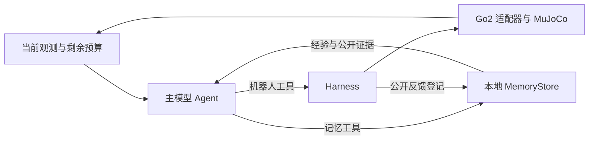

# MemoryAgent 实验与离线演示

MemoryAgent 在现有公开观测与 Harness 动作接口上增加持久记忆工具和当前回合工作笔记。它负责工具分流，不单独调用大模型，也不代替模型规划、运动控制或独立评分。默认 `--memory off`，继续原有流程。

启用记忆的运行属于 **`memory-demo-v1` 实验**，不能进入原 `go2-model-eval-v2`／`v3` 正式榜单，也不能与旧成绩直接排名。旧运行记录和评分规则保持原样。

## 模型如何使用记忆

模型仍然每轮请求一个工具并检查反馈。启用后增加五个工具：

| 工具 | 用途 |
| --- | --- |
| `memory_search(query, limit)` | 检索当前作用域中的持久教训，返回条目 ID、版本和摘要 |
| `memory_read(memory_id, version)` | 读取全文、版本与已保存的公开来源证据 |
| `memory_save(text, evidence_refs)` | 根据已登记的公开反馈保存教训 |
| `memory_revise(memory_id, expected_version, text, reason, evidence_refs)` | 用版本检查修订条目，保留历史版本 |
| `memory_working_note(text)` | 更新本回合的临时工作笔记 |

`agent_context` 提供本回合 ID、剩余预算、记忆状态、工作笔记和可引用的公开证据 ID。证据来自已完成的机器人公开观测与工具反馈；记忆工具自己的输出不能作为新教训的自证来源。

当前检索是大小写不敏感的字面子串匹配，使用短关键词；空查询可列出有限条候选。这个 demo 没有向量库、语义检索或自动总结。程序负责接口校验、持久化和执行限制，何时检索、记住什么、如何使用经验由模型决定。



记忆中的教训是待核对的数据。它不会成为系统指令，也不能证明当前目标位置、穿门成功或当前物体身份。先前的运动命令与当前实测位移必须区分；检索到的教训也不能绕过工具参数校验、停止确认和最终独立验收。

## 启用方式

数据库路径固定为 `--memory-dir` 下的 `memory.sqlite3`：

| 模式 | 持久库 | 工作笔记 |
| --- | --- | --- |
| `off` | 不打开数据库 | 不启用记忆上下文与工具 |
| `read_only` | 只读；库不存在时尽早报错 | 可更新本回合 RAM 笔记，不写入数据库 |
| `read_write` | 可读取、保存与版本修订 | 可更新本回合 RAM 笔记 |

长期教训可在关闭、重开后检索。**工作笔记只保留在当前回合内，下一回合从空白开始。** 下一回合可检索长期教训，再主动写自己的工作笔记。

下面是实际模型运行命令，会发出真实 API 请求；离线演示不需要执行它：

```bash
.venv/bin/python -m go2_demo --mode api --provider deepseek \
  --task go_avoid_texture_drawers \
  --memory read_write --memory-dir .local/memory-demo/go2
```

只读复用同一持久库：

```bash
.venv/bin/python -m go2_demo --mode api --provider deepseek \
  --task go_avoid_texture_drawers \
  --memory read_only --memory-dir .local/memory-demo/go2
```

记忆工具操作也占普通模型决策轮次，所有真实模型请求都受同一总调用、墙钟及单次 API 超时预算约束；没有额外的免费记忆调用。`finish`、`abort`、安全失败或预算结束后不能通过记忆工具继续本回合。记忆实验的 token 缺失项和失败请求用量仍是未知，不应按零费用处理。

## 真实 DeepSeek 与 Go2 两回合演示

```bash
MUJOCO_GL=egl .venv/bin/python scripts/run_memory_trial.py
```

默认使用现有 `deepseek-flash` API 和真实 Go2／MuJoCo 抽屉柜绕障场景，固定 seed 0。每回合最多 30 次模型调用、300 秒墙钟时间、120 秒仿真时间，没有自动重试。密钥遵循现有配置，从本地文件读取，不写入结果。

第一回合明确要求模型在完成任务前保存至少一条有公开反馈支持的经验；第二回合重新启动机器人和模型，以只读方式打开同一记忆库，明确要求模型自主检索、阅读并判断经验的适用性。具体查询词、记忆文字和机器人动作均由模型生成。该指令设计用于检查真实模型能否使用工具，不证明模型会自发使用记忆，也不用于证明记忆提升了性能。

输出在新的 `runs/<时间>-memory-api-demo-<ID>/` 下：`experiment.json` 冻结 Git／源码／提示词与预算，`remember/`、`recall/` 保存两回合原始记录，`memory/memory.sqlite3` 保存经验，`summary.json` 汇总结果。完整演示通过要求：两个机器人任务严格成功、第一回合实际保存经验、第二回合实际检索和读取，以及只读前后记忆内容哈希一致。缺项和失败照实保留，不进入正式榜单。

### 2026-11-09 实跑结果

在干净提交 `684dff0` 上运行，两个回合都通过独立任务验收，完整演示 `demonstrated=true`。真实请求 45 次，无自动重试。

| 维度 | 第一回合：保存 | 第二回合：只读复用 |
| --- | ---: | ---: |
| 严格任务成功 | 是 | 是 |
| 墙钟时间 | 228.89 秒 | 256.50 秒 |
| 实际路径长度 | 3.574 米 | 3.332 米 |
| 仿真时间 | 28.86 秒 | 32.34 秒 |
| 模型调用数 | 20 | 25 |
| 记忆工具调用数 | 1 次保存 | 6 次检索、2 次读取 |
| API 报告的总 token | 449,789 | 590,510 |

第一回合保存 1 条经验、4 个公开证据引用；第二回合读到相同版本与证据，初末规范记忆哈希均为 `a8fe43674412228c003931e6050ed22fba38ae5c9354b576bd7fcc726a9260a0`。两次 API 清单均记录代码无未提交改动。路径从完整 50 Hz XY 轨迹计算，包含停稳漂移。

**本次也暴露了实际限制**：英文关键词查不到中文经验，模型转为空查询后读取，后面又重复检索；保存的文字混淆水平／三维距离，并提出未经验证的位移补偿比例。证据引用提供可追溯性，不代表文字已经事实核验。第一回合一次超长移动请求被拒绝；第二回合一次运动超时、一次超长请求被拒绝，均保留在日志，之后恢复并通过验收。

第二回合路径较短，但时间、调用和 token 更多；这一组带不同演示指令的运行不能证明记忆提升性能。本次真实模型只验证了保存和读取，没有执行版本修订；修订由单元测试覆盖。

[完整实验报告](../runs/20261109-225847-memory-api-demo-8bf1c5/REPORT.zh-CN.md)、[机器可读汇总](../runs/20261109-225847-memory-api-demo-8bf1c5/summary.json)、[路径等离线分析](../runs/20261109-225847-memory-api-demo-8bf1c5/analysis.json) 保存在本地运行目录。原始运行数据和 SQLite 不随 Git 分发；上表与结论保留在版本化文档中。

## 无 API 的持久化演示

```bash
.venv/bin/python scripts/validate_memory_demo.py
```

[演示脚本](../scripts/validate_memory_demo.py) 使用脚本化假模型和假后端，不读取密钥、不请求 API、不加载 MuJoCo、预训练步态或任务评分器。合成反馈刻意表示“请求前进 0.30 米、实测只前进 0.23 米”，用来检查接口与记忆持久化；它不代表真实机器人执行精度，也不是生产规则策略。

演示依次进行：

1. 假模型经 MemoryAgent 将一次运动交给 Harness，取得公开的实测反馈。
2. 引用该公开反馈保存一条教训，并写本回合工作笔记。
3. 关闭持久库，再以 `read_only` 打开同一数据库。
4. 新回合从空工作笔记开始，检索并读取旧教训，再写新的本回合笔记。
5. 验证只读前后数据库文件 SHA-256 和规范逻辑内容 SHA-256 均未改变。

每次演示创建新的 `runs/<时间>-memory-demo-<ID>/validation.json` 及该目录下的测试记忆库，不覆盖旧记录。结果明确标注 `is_llm_result: false`、`api_requests: 0`、`simulator_used: false`、`model_score: null`，保留公开调用过程与哈希核对结果。假模型只决定固定演示步骤，不提供任务成功率或模型分数。

对应回归测试：

```bash
.venv/bin/pytest -q tests/test_memory_demo.py
```

2026-11-09 的本地离线检查已通过：[本次原始验证记录](../runs/20261109-144838-memory-demo-ca817d/validation.json)。两个回合共 10 步脚本化决策，API 请求为 0；记录中的六项接口与持久化检查均通过。对应的 2 项演示回归测试通过。该运行目录为本地生成的证据，不随 Git 分发，也不构成真实大模型实验成绩。

## 真值与版本边界

MemoryAgent 的写入输入限于公开观测和工具反馈，不导入旧 `runs`、独立评分器结果、目标真值或隐藏几何。持久条目按机器人配置作用域隔离；有来源证据不代表教训文本已经被验证为事实。

本轮基础代码检查点为 `3fc6b90`（标签 `checkpoint/robot-adapters-20261109`），记忆功能提交为 `684dff0`；都位于 `feature/memory-agent-demo` 分支。应用版本为 `0.2.0`，实验协议名为 `memory-demo-v1`。本次功能提交上全套测试 **718 项通过**。离线输出记录当前源码与验证脚本 SHA-256；它验证记忆接口与持久化，不证明真实模型任务能力有所提升。
