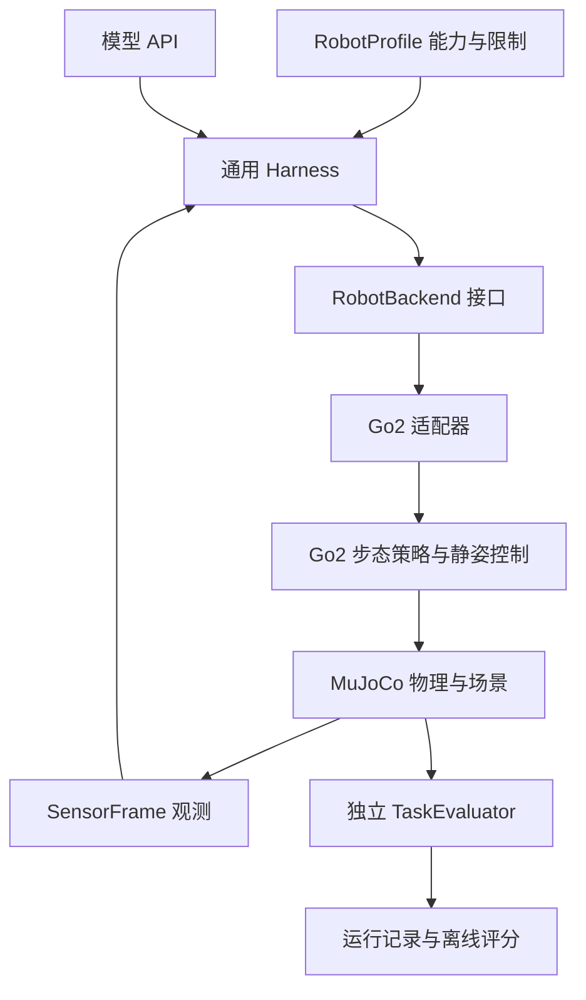

# 机器人适配架构

当前实现将型号相关的控制封装在适配器中。已可运行的组合只有 **Go2 / MuJoCo**；通用接口不代表其他型号或实机已经接通。历史 Python 包名 `go2_demo` 保留，以兼容脚本和已有实验入口。



## 模块与职责

| 模块 | 职责 |
| --- | --- |
| `go2_demo/robots/profile.py` | 不可变的能力、动作限制、姿态限制、传感器与尺寸定义；参数校验 |
| `go2_demo/robots/contracts.py` | `RobotBackend`、`IndependentTaskEvaluator` 和 `SimulationEpisodeBackend` 结构协议 |
| `go2_demo/robots/registry.py` | 显式选择型号与后端，延迟加载实现；未知组合直接拒绝 |
| `go2_demo/robots/go2/profile.py` | Go2 的固定配置 |
| `go2_demo/robots/go2/backend.py` | Go2 动作执行、观测采集、物理控制及停止 |
| `go2_demo/robots/go2/posture.py` | Go2 四足静止姿态逆运动学 |
| `go2_demo/harness.py` | 根据配置生成工具、幂等调用、观测白名单、声明完成 |
| `go2_demo/environments/mujoco.py` | 从显式机器人 XML 构造仿真场景；场景物体与目标几何 |
| `go2_demo/task_evaluation.py` | 根据独立仿真状态验证到达、穿门、复合阶段及安全条件 |
| `go2_demo/runner.py` | 当前暂停式仿真回合、预算、日志与资源收尾 |
| `go2_demo/provenance.py` | 机器人配置摘要及递归源码指纹 |

旧 `go2_demo.backend`、`go2_demo.posture` 导入路径保留兼容入口。`harness.TOOLS` 是旧 Go2 工具的惰性兼容导出；新运行路径始终使用实例 `harness.tools`，不依赖全局工具表。

## 运行流程

1. 注册表解析 `--robot go2 --backend mujoco`，获得不可变配置。
2. 任务检查所需能力，并根据配置绑定相机安装偏移。Go2 的原始指令、场景尺寸和判据保持原值。
3. Go2 适配器校验锁定资产、构建 MuJoCo 场景、加载步态策略，绑定独立评估器。
4. Harness 根据能力生成工具及参数范围，读取传感器帧。模型提示词绑定同一机器人身份与能力。
5. 模型每次选择一个工具；Harness 校验并去重，再通过 `backend.execute(ToolCall)` 执行机器人动作。
6. 控制器返回实测位移、转角、误差与状态；Harness 更新观测，继续下一轮。
7. `finish` 只记录完成声明。独立评估器核验物理结果，runner 同时核验停稳、预算和终止原因。
8. 保存配置、实际提示词、实际工具、轨迹、图像和结果；最终停止并关闭资源。

## 接口与能力

`RobotBackend` 提供 `profile`、`capture()`、`execute(call)`、`stop()`、`cancel()`、`close()`。核心接口是同步的：执行返回最终结果，不能把接受请求当作动作完成。

工具生成与执行校验共享 `RobotProfile`。没有姿态能力时不向模型提供调姿工具；没有深度或跟踪能力时不提供点测距工具；没有横移能力时 `lateral_m` 只能为零。强行调用被禁用的已知工具会明确返回 `UNSUPPORTED_CAPABILITY`。适配器自身也要校验，不能只依赖 Harness。

当前 Go2 的 `cancel()` 只能在空闲时请求物理停止；动作执行期间返回明确的不可抢占结果。它不是实机急停或后台中断服务。实机需要独立持续控制循环、通信状态与命令超时机制，本轮没有实现这些模块。

`SensorFrame` 区分仿真时间、采集时间、定位来源、定位质量与深度质量。缺深度、缺定位或无效标定时不构造虚假几何。缺定位时局部里程计不可用，恢复定位时明确参考帧；静态点跟踪仍依赖一致的局部坐标系，尚未验证 SLAM 重定位或动态场景。

通用 Harness 可以处理缺失观测。当前 `run_episode` 是暂停式仿真评测入口，额外要求 `SimulationEpisodeBackend`、独立评估器和有效的时间／RGB／定位数据；它会在首次 API 请求前拒绝不支持的运行方式。不能仅实现最小 `RobotBackend` 就宣称已支持整个仿真评分流程。

## Go2 保留的行为

- 步态策略与轨迹 50 Hz，MuJoCo 及 PD 500 Hz；步态 PD 为 20／0.5，静止调姿 PD 为 120／2。
- 模型工具单次位移上限 0.6 m，转角上限 0.6 rad；原始低层兼容方法仍保留自身防御限制。
- 静止高度范围 0.24–0.36 m，仰角 ±0.2 rad，并满足组合约束与逆运动学可达性。
- 调姿后 `stop` 保持姿态，移动前必须显式 `reset_posture`。
- 等待模型时物理暂停；无自动全局规划或绕障；碰撞、跌倒、停稳与任务判据不放宽。
- 配置中的 `torso_box_size_m` 是躯干碰撞盒尺寸，**不是包含四肢和运动摆幅的整机通行包络**。

本次真实接口检查同时修复了一个原有调姿边界：行走后实测站高可能略超过 0.36 m，控制器曾把这个起点按用户目标范围拒绝。现在用户目标仍严格按原范围校验，实测起点及内部平滑参考使用有限数、关节限位与原 IK 可达性检查；没有扩大用户目标范围，也没有直接移动机器人位姿。

## 使用与验证

```bash
python -m go2_demo --list-robots
python -m go2_demo --robot go2 --backend mujoco --describe-robot
python -m go2_demo --robot go2 --backend mujoco --list-tasks

# 本地真实物理验证，无模型 API
python scripts/validate_robot.py --robot go2 --backend mujoco
python scripts/validate_composite.py
python -m pytest -q

# 模型闭环，会调用 API
python -m go2_demo --robot go2 --backend mujoco --task go_avoid_texture_drawers --viewer
```

安装项目后也可用 `robot-harness` 替代 `python -m go2_demo`。需要图形环境时沿用原 WSLg／EGL 配置，见 [运行说明](demo.md)。

`validate_robot.py` 验证移动、转向、停止、调姿、姿态模式下拒绝移动、恢复与空闲取消。记录在新的 `runs/*-robot-adapter-validation-*/validation.json`，明确标注 `api_requests: 0`、`is_llm_result: false`、`model_score: null`。它的成功表示接口与控制检查通过，不表示目标任务或大模型评测成功。复合场景脚本同样只验证可达性。

2026-11-05 验证记录：

| 验证 | 结果与记录 |
| --- | --- |
| 完整测试 `MUJOCO_GL=egl .venv/bin/python -m pytest -q` | 635 passed，13.08 秒 |
| Go2 真实接口检查 | [通过记录](../runs/20261105-095651-robot-adapter-validation-ea4b01/validation.json)；移动、转向、调姿、恢复与停止通过，静姿移动按预期拒绝 |
| 复合场景可达性 | [通过记录](../runs/20261105-095503-composite-scripted-validation-d6fe5a/validation.json)；绕柜、穿门、接近 B 三阶段全部通过，无碰撞或跌倒 |
| 调姿边界修复前的失败 | [原始记录](../runs/20261105-095321-robot-adapter-validation-e3ab6e/validation.json)；保留，未覆盖 |
| 旧模型实验离线重算 | DeepSeek 65 个有效回合、60 成功，82.9629312744；与旧报告一致 |

本次测试没有调用真实模型 API。HTTP 协议测试使用本地 mock；真实物理检查使用脚本指令，不能作为新的大模型成绩。

## 实验记录与兼容

每回合新增 `robot_profile.json`，manifest 记录 `robot_id`、完整 profile、`robot_profile_sha256` 和执行合同版本；源码摘要递归覆盖新子目录。归档的 `tools.json` 与 `system_prompt.txt` 就是该回合实际使用的配置。

`metrics.json` 增加 `model_wait_s` 和 `action_execution_wall_s`。前者包括模型适配器请求等待，不能解释为纯网络或纯推理耗时；后者包括工具执行、观测刷新和最终停稳。两者不含所有初始化、评估与日志开销，因此不要求其和等于总墙钟时间。仿真时间另行记录。

v2／v3 的评分权重、任务数量与验收阈值保留。新建计划冻结机器人配置、新工具和提示词；协议摘要与旧计划不同，不能继续执行旧计划或混合排名。旧记录仍可按原冻结证据离线评分；没有重写历史运行目录。当前正式评分依然只针对 Go2 仿真，不提供跨机器人排行榜。

## 下一型号接入要求

为新型号新增独立 profile 和适配器，在注册表显式注册。使用该型号经过验证的运动控制器，并满足共同动作语义、实测反馈和传感器约定。不能静默把横移替换为改变路径的组合动作，也不能复用 Go2 权重就视为控制适配完成。

接入当前仿真回合还需提供场景实例、仿真时钟、轨迹及独立评估器。先验证基本运动、观测标定、停稳和不支持能力的拒绝，再验证任务几何对该机器人可行，最后运行模型比较。尺寸与传感器改变后，需要冻结新的实验配置并分别报告结果。
